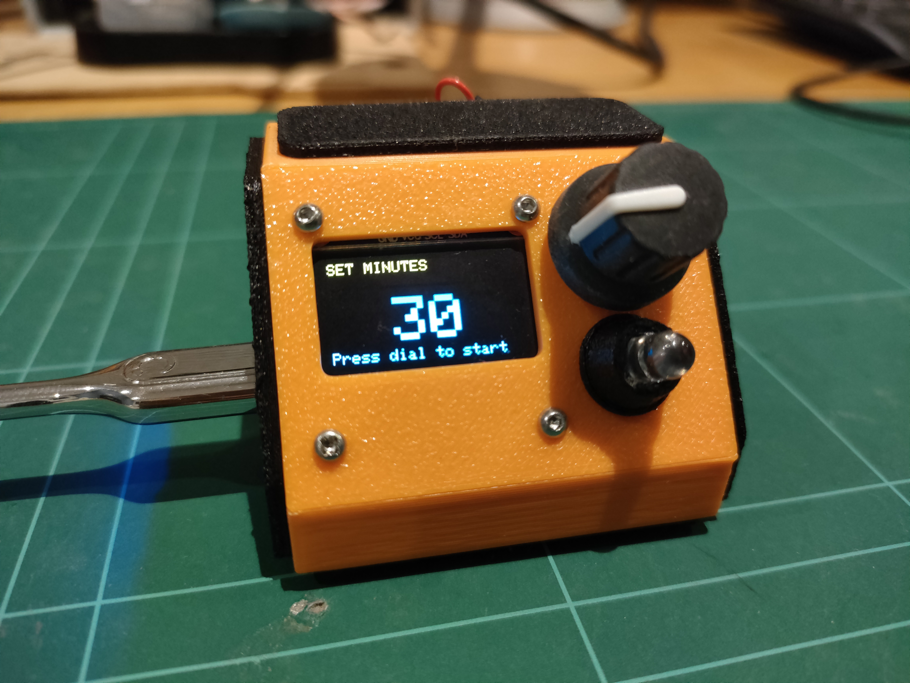
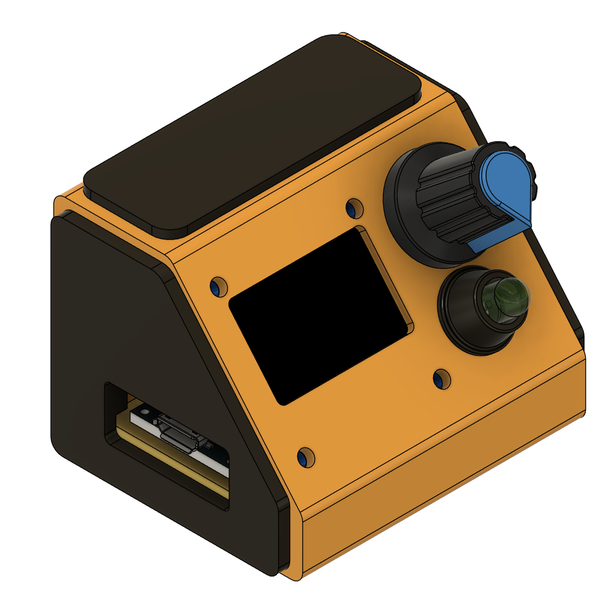

# DIY Pomodoro Timer Project

<!-- PROMPT: One sentence. What is this and what does it do?
     e.g. "STM32-based SBUS transmitter for controlling RC/UGV platforms." -->

A custom Pomodoro-inspired timer providing a user-friendly interface to set desired working and break time periods. 




<!-- PROMPT: Replace with a real photo/gif of the finished hardware, or a short demo video link.
     This matters more than any paragraph of text for a hardware project. -->

## Why I built this

<!-- PROMPT: 2-3 sentences. What problem were you solving, or what were you trying to learn?
     Keep this short - the story belongs on your Wix portfolio, this is just context. -->
I wanted to build a custom timer project, not only to use up spare electronics I had lying around but also to make a useful electrical-mechanical device for studying or concentrating on tasks. This would be a fun way to help avoid procrastination and technological distractions which are present in today's world.

## Status

<!-- PROMPT: Pick one and delete the rest -->
🧪 Prototype / proof of concept

## Hardware

<!-- PROMPT: Bullet list of key components. Not exhaustive - just what a reader needs to
     understand the build. -->
- MCU: Arduino Micro
- Interface: I2C, PWM, Digital I/O
- Key components: 
  - Rotary encoder with pushbutton
  - Piezo-electric Buzzer
  - OLED 0.96" I2C LCD display (SSD1306)

## Features

<!-- PROMPT: What can it actually do? Bullet list, specifics over adjectives. -->
- User-settable duration for each of the four successive study breaks
- Encoder used to set the minutes. Push button used to confirm the work session
- Encoder push button can be used to pause/resume in the middle of a work session
- Buzzer and LED alert the end of the session
- 5min break between sessions hard-coded into timer
- Compact display. Perfect for desktop use

(See images in folder for the examples of a pomodoro break, running pomodoro session and timer start screen)

## Repo Overview
<!-- PROMPT: Brief map of folders, especially if there are exported PDFs/gerbers alongside
     native project files (Altium, CubeIDE, etc.) -->

```
/CAD           - CAD files for the timer frame, LED mount and blanking plates
/Electrical    - KiCAD schematic
/Software      - Arduino Micro source code
```

## Build / Flash Instructions

<!-- PROMPT: Only include if someone could realistically reproduce this.
     If it's too bespoke to your hardware, say so and skip to Repo Structure instead. -->
1. Open Arduino IDE 
2. Ensure following libraries are installed:
  * Adafruit_GFX
  * Adafruit_SDD1306
  * Wire  
3. Upload countdown_timer.ino into Arduino Micro on its COM port

## Future Work

- Make it into a PCB
- Redesign with ESP32 for more compact and wireless features
- Make it portable (battery powered)

<!-- ## Links -->
<!-- PROMPT: Cross-link to the portfolio page for this project once it exists -->
<!-- - Portfolio: [jonathanloong9328.wixsite.com/jlrobotics](https://jonathanloong9328.wixsite.com/jlrobotics) -->